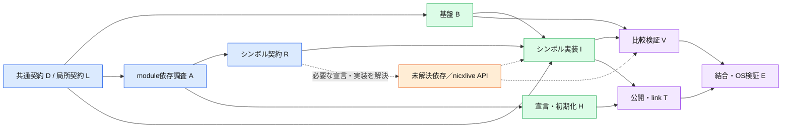

# 全WBSの並列化分類

これは全葉の統計表。エージェントへの実作業割当は [assignments.md](assignments.md) を参照する。

tasks.md全葉を対象とする。分類元SHA-256: `97298064b868031338467d76bf37e125f54222315189b06ca6a934370c0015ba`。

全葉のID・参照行・段階・依存ID・未解決条件・着手可否は [leaves.csv](leaves.csv)。
再計算: `python tools/analyze_cpp_wbs.py`。チェック状態はtasks.mdを正とする。

## 数え方

- 全葉: 39,460件、チェック済み: 9334件。
- 明示依存の段階: 15段階。段階×作業種別による管理グループ: 50群。全葉にgroup IDを付与した。
- 全工程を他群から切り離して完遂する独立群: 1群（明示依存の弱連結成分）。共通設計・基盤を共有するため分離できない。
- 現時点で記載済みの前提を満たして着手できる葉: 2435件。内訳: {'B': 22, 'A': 80, 'R': 2333}。
- 着手可は作業開始条件であり、契約調査で依存先を解決したことや、完了を保証しない。
- 宣言・呼出し・結合対象の集合をCSVへ未展開の葉: 26,268件。契約票で解決済みの完了葉50件も含むため、実際の未解決件数ではない。実装最大並列数は未確定。
- 同じ段階の葉は明示グラフ上で相互に依存しない。未解決依存を解消すると段階は変わり得る。
- 段階×作業種別のグループは管理用の集合であり、同時実行数ではない。共有ファイルの書込は担当を一人に固定する。
- importを全関数本体の依存へ展開しない。Rで宣言依存と実行依存を区別し、循環は宣言契約を先行して結合検証する。
- nicxlive不足APIは外部未解決条件。D38/B009の生成実体照合による追加葉もこの件数には未反映。

## 全件分類

| 段階 | D | B | A | R | L | H | I | V | T | E | 計 |
|---|---:|---:|---:|---:|---:|---:|---:|---:|---:|---:|---:|
| 0 | 1 | 0 | 0 | 0 | 0 | 0 | 0 | 0 | 0 | 0 | 1 |
| 1 | 3 | 5 | 355 | 0 | 1 | 0 | 0 | 0 | 0 | 0 | 364 |
| 2 | 10 | 7 | 0 | 4307 | 0 | 355 | 0 | 0 | 0 | 0 | 4679 |
| 3 | 9 | 5 | 0 | 7673 | 0 | 0 | 398 | 0 | 355 | 5 | 8445 |
| 4 | 7 | 9 | 0 | 649 | 0 | 0 | 819 | 0 | 0 | 6 | 1490 |
| 5 | 6 | 3 | 0 | 110 | 0 | 0 | 1098 | 0 | 0 | 6 | 1223 |
| 6 | 4 | 2 | 0 | 12 | 0 | 0 | 3157 | 1941 | 0 | 6 | 5122 |
| 7 | 0 | 2 | 0 | 1 | 0 | 0 | 3203 | 2881 | 0 | 3 | 6090 |
| 8 | 0 | 5 | 0 | 0 | 0 | 0 | 3974 | 2952 | 0 | 0 | 6931 |
| 9 | 0 | 6 | 0 | 0 | 0 | 0 | 103 | 4408 | 0 | 0 | 4517 |
| 10 | 0 | 0 | 0 | 0 | 0 | 0 | 0 | 500 | 0 | 18 | 518 |
| 11 | 0 | 0 | 0 | 0 | 0 | 0 | 0 | 54 | 0 | 9 | 63 |
| 12 | 0 | 0 | 0 | 0 | 0 | 0 | 0 | 14 | 0 | 1 | 15 |
| 13 | 0 | 0 | 0 | 0 | 0 | 0 | 0 | 1 | 0 | 0 | 1 |
| 14 | 0 | 0 | 0 | 0 | 0 | 0 | 0 | 1 | 0 | 0 | 1 |

段階は明示依存のみの最長経路による。未解決依存を満たしたものとして実行してはならない。

## 段階の意味

- D/L: 共通・局所契約。B: ビルド／比較基盤。A: moduleの依存調査。
- R: シンボル契約。H: 宣言と初期化の接続。I: シンボル実装。
- V: D/C++比較。T: module公開・link検証。E: シナリオ／OS結合検証。

図は工程の要約（V→E/T→Eは結合完了方針）。正確な列挙済み辺はCSVを参照。
