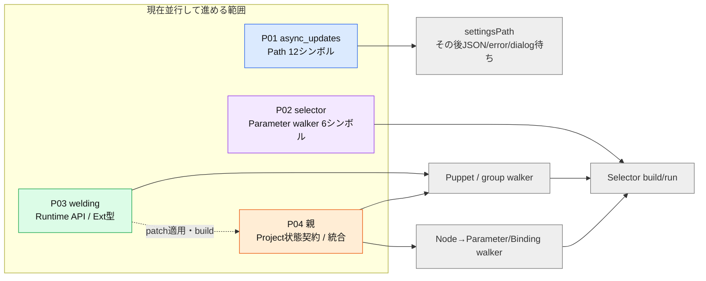

# エージェント実行用の割当表

> 2026-10-29: 以下の担当表・葉ごとの停止条件は過去の投入履歴である。
> 現在の実装は全MxxxについてD原本ファイル全体を一人の実writerが担当し、
> 全本体・実provider・公開接続を揃えて自己レビューするまで継続する。
> 現担当と明示的な引継ぎはKanban実タスクコメントで確認する。
> シンボル別WBSは網羅性・依存の索引であり、関数単位の終了を指示しない。
> ビルド・テスト・検証コード生成は現在のユーザー指示により行わない。
> 詳細は [tasks.mdの実装実行規約](../../../tasks.md) を参照。

更新: 2026-10-25。従来の15段階・50管理群は統計であり、この割当表の代わりにはならない。
人数の妥当性・追加候補・依存待ちの評価は [capacity.md](capacity.md) を参照。
全39,460葉の実装依存を解決したとは主張しない。以下は現ソースと比較結果から切り出した
現在の実行パケットである。残りの葉は依存調査待ちであり、無条件に実装へ配らない。

## 現在投入する4担当

### 最新の投入キュー

全サブエージェントはGPT-6.1 Solで稼働する。前任者の割当は下段の引渡し履歴として扱う。
サブエージェント3名＋親1名の4枠を使用する。これは現在の投入数であり全WBSの最大並列数ではない。

次タスクは依存索引から前提が充足した葉だけを抽出し、編集所有の競合を除外して選ぶ。
候補内では後続の解放数が多いもの、同数ならWBS ID順を優先する。ランダムには選ばない。
着手時にID・先行成果物・充足証拠・所有範囲を報告する。隔離テスト成功と親統合成功は区別し、
統合待ちの成果物へ依存する実装は保留する。独立した契約調査は別の葉として進められる。

| 実行中担当 | 現在のパケット | 先行条件と競合しない理由 |
|---|---|---|
| sol_transform | D32.C: AutoRig artifact/workspace/cache/resume契約 | D03.C/D17.Cがチェック済み、未所有。専用契約・証拠を所有。M340.A/M070.Aは親レビュー済み |
| sol_node | WeldingLink typed schemaとDrawableの依存調査 | 基底Node202ケース・SimplePhysics324ケース・SharedArrayの親統合検証済み。MeshDataは全体テスト中。専用fixtureと外部patchを所有 |
| sol_binding | Deformation binding入出力・復元の接続 | DeformSlot548ケース・回復計算301ケース・TLS診断38行が親統合検証済み。Binding接続1584ケースは隔離比較済み、親統合待ち。専用patch/fixtureを所有 |
| 親 | Node/Transform/Binding統合、共通Puppet結合の前提整理 | 共有CMake・外部patch適用・統合build/test・Kanban同期を単独所有。他担当の専用ファイルを同時編集しない |

次の表と詳細節は各系統の前段・引渡し条件を示す。現在の実行位置はこの最新キューを優先する。

| パケット | 担当 | 今渡す作業 | 他担当を待たず進める範囲 | 次の停止点 |
|---|---|---|---|---|
| P01 Path | async_updates | M124.S0001–S0012の契約・実装・比較 | TLS cache、定数、5関数の環境/ファイル系比較 | 空環境値のnull区別、Windows UTF-8環境取得が一致するまでsettingsへ進めない |
| P02 Selector binding walker | selector | M127.S0039–S0044の契約・実装・比較 | 適用済みordered bindings APIを使用。順序/祖先filter/参照同一性を検証 | M127.S0045以降はP03/P04の実型・状態境界を待つ |
| P03 Runtime/Ext | welding | nicxlive lifecycle不足APIとM145/M146の下記範囲 | factory、仮想呼出し、親子/group再構築の契約・patch・比較fixture | 親のpatch適用/buildを待つ。未実装dup/全serde/全Ext登録を完成扱いにしない |
| P04 Project契約/統合 | 親 | M193の状態所有・getter契約と共通build/test | D原典から実Project状態の所有関係を確定。共有CMake、patch適用、回帰検証 | Project全体の実装をgetter用の偽状態で代用しない |

P01/P02/P03は現在の先行成果物を使って並行作業できる3パケット。
P04は共通成果物の適用と結合を直列に管理しながら、Project契約を独立に調査する。
これは「全移植が4つの独立群に分かれる」という意味ではない。

## P01: Path → settings保存

- 葉: M124.S0001–S0007（TLS状態/定数）、S0008（config）、S0009（imgui）、
  S0010（fonts）、S0011（locale）、S0012（localeExtra）。各.R/.I/.Vは別判定。
- 入力: `source/nijigenerate/core/path.d`、プロセス環境、cwd、既存ファイル/ディレクトリ。
- 編集所有: `native/src/nijigenerate/core/path.*`、専用platform adapter、path専用test/契約票。
  `compat/slice.hpp`と既存actionstack/settingsもこの担当が所有する。
- 受入: 原Dの未変更moduleとの比較で、返却文字列、空/null、キャッシュ、TLS、mkdir順序を照合。
  OS別差分がある限り該当.Vは未完了。
- 解放: M131.S0002（settingsPath）。その後S0003/S0005/S0006の保存・読込を解放するには
  JSON/error契約が必要。S0004のdialogはUI依存で別ゲート。path完了だけで保存全体をreadyにしない。

## P02: Selectorの先行可能部と待ち部分

- 済の比較を利用: M126/M129 parser/tokenizer、M128 Resource、M130 TreeStore、
  M127.S0002–S0038のCache/filter/Node walker（全.V完了を意味しない）。
- 今の葉: M127.S0039–S0044。`Parameter.bindings`からResourceを生成し、祖先Nodeで絞り込む。
- 編集所有: `native/src/nijigenerate/core/selector/*`、selector専用test/契約票。
- 受入: 挿入順、重複、同じUUIDの別Node、祖先あり/なし、Proxy型変換失敗をD契約と比較。
- 次の葉:
  - S0045–S0055: NodeからParameter/Bindingへ。P04の`incActivePuppet`/`incArmedParameter`実状態が必要。
  - S0001/S0056–S0058: PuppetWalker。さらにP03の実ExPuppet.groups/ExParameterGroup.childrenが必要。
  - S0059–S0065: Selector.build/run。上記walkerと数値変換契約の後で結合する。
- 待ち中は.R/宣言まで。独自activeProject、仮のarmedParam、mapから順序を推測する実装を作らない。

## P03: nicxlive → editor拡張型

- 葉: M146.S0001–S0022/S0024–S0025、M145.S0001–S0014/S0016–S0017。
  外部runtimeの不足APIはこれらの入力依存として扱う（現WBSには外部API個別IDがまだない）。
- 入力: 現行nijigenerate ext/param.d・ext/package.d、nijilive param/package.d・puppet.d・runtime_state.d。
- 編集所有: `native/src/nijigenerate/ext/{param,package}.*`、ext/parameter専用test/契約票。
  nicxlive変更は専用patchへ出し、外部checkoutへの適用は親のみ。
- 先行済み入力: ordered bindings API。未受入入力: factory TLS/default登録、仮想lifecycle、Parameter serde。
- 受入: 実nicxliveによるattach/detach、constructor差、group再構築、virtual呼出し順、factoryのTLSを比較。
  Dと初期化前の失敗種別が違えば差異を残す。
- 解放: P02のgroup/Puppet walker、後続Projectとparameter commands。
- 別待ち: M146.S0023 dup、M145.S0015 Puppet serialize、M145.S0018 incInitExt。
  axis共有、全Puppet serde、残りExtNodesを解決してから扱う。

## P04: Project状態契約と共通成果物

- 契約対象: M193.S0001/S0004/S0032/S0034/S0037/S0046/S0076/S0077/S0079。
  Project型、puppet、EditMode、activeProject、armedParam、getterの所有・既定値・状態依存を確定する。
- 入力: `source/nijigenerate/project.d`、P03の実型、既存Action/async更新スコープ。
- 編集所有: Project契約票と将来の`native/src/nijigenerate/project.*`、CMake、tasks.md、
  全体依存表、nicxlive patch適用。型骨格は実Projectの宣言として扱い、模擬Projectを作らない。
- 受入: getterの戻り値だけでなく、実状態の所有者と初期化/切替の接続先を確定。
  未実装のProject生成・通知・切替を隠したままP02の全結合を完了としない。

## 引渡しと競合回避

1. 各担当は契約票に「直接呼出し先WBS/API、必要宣言、実行に必要な実装、観測方法」を記録する。
2. 実装依存が未解決の葉は`.R`/宣言で停止し、下流へready通知しない。
3. 完了通知はパケット名だけでなく、葉ID、変更ファイル、build/比較結果、残差異を付ける。
4. 共通ファイルは親、SliceはP01、selectorはP02、Ext/runtime patchはP03の単独書込とする。
   他担当は変更要求を送る。別担当の所有ファイルを同時編集しない。
5. 受け手は前提APIの実装・比較証跡を確認してから後続.Iへ進む。
6. まだ割当のない全WBSは`leaves.csv`の索引から.R候補を取る。50群の数字で割当せず、
   上記の入力/出力/所有者/停止点が確定したパケットだけ次に投入する。

