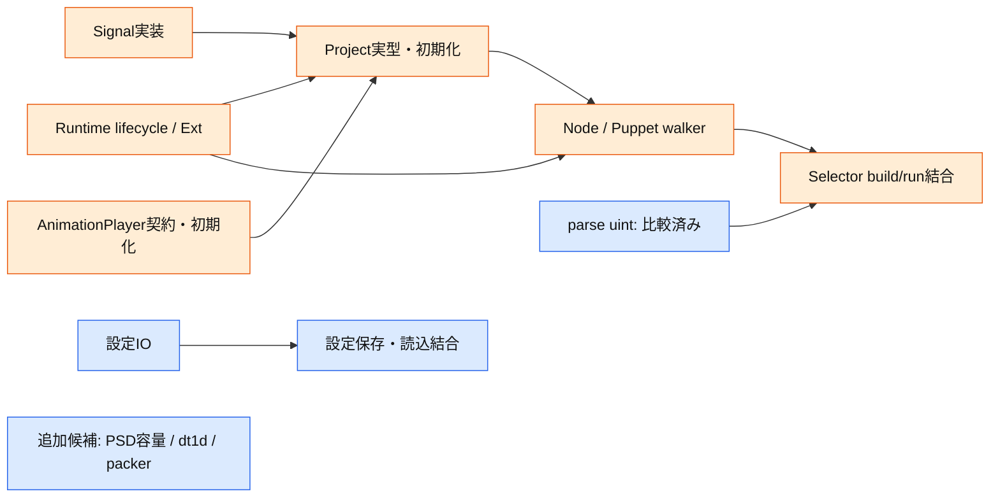

# 3サブエージェントで十分か

2026-10-25。結論: **3は現在の実行枠上限であり、作業の最適並列数ではない。**
親を含む4枠しかないため実投入は3名だが、現ソースには追加で独立に契約調査・実装準備を
進められる対象がある。3名で十分、または6名が最適という性能上の証明はない。

## ソースから確認した候補

| 系統 | WBS/処理 | 他系統への依存 | 書込み所有/制約 |
|---|---|---|---|
| 設定IO | M131.S0002/S0003 | 比較済みM124 Path、時刻/renameの外部契約 | path/settings担当 |
| Project Signal | M193.S0007–S0023のSignal契約/実装 | Phobos std.signalsの原典、所有権契約。nicxlive新APIは不要 | compat/signalと専用tests。Project本体は親 |
| Runtime binding複製 | M146.S0023のcreateBinding/setZero/axis共有 | 現nicxlive型とD runtime原典 | nicxlive patchとExt担当。共有runtime変更は同じ担当へ集約 |
| PSD容量計算 | M158.S0001–S0003 | 整数の幅/overflow/変更順序のみ。S0003→S0002は同packet内依存 | psdbudget専用出力。Layerを受けるS0004はPSD型待ちなので含めない |
| 1D距離変換 | M106.S0001/S0002 | 数値/配列契約。dt1d本体はmir.ndsliceやFiberを呼ばない | CV distance専用出力。空配列のD失敗も比較。2D処理/RCArrayは含めない |
| アトラス矩形配置 | M033.S0001–S0024 | inmath整数ベクトル、D配列/remove、例外/format契約。Texture/Puppet呼出しなし | packer担当一人。Bin状態を複数担当で同時編集しない |

この6系統は相互の実装完成を待たず、各々の契約確定から進められる下限の候補数。
追加3系統の全.Rはまだ完了しておらず、全.I/.Vが即時着手可という件数ではない。
全WBSの最大並列数とも異なる。M118 extractPathはFiber.yield/ndslice/共有配列依存があるため、
単に数学moduleという理由で独立実装枠へ含めなかった。

## 人数より先に解くべき待ち

現在の主要な結合経路は次の通り。

parse!uint担当が実装と2,084比較ケースを終えたため、その枠をSignalへ移した。
独立数値処理を増やすだけではProject待ちは解消しない。Runtime担当へさらに人数を追加すると
同じparameter.hpp/binding_impl.hppを編集するため競合が増える。そこは一人を維持する。

## 現在の配置と増員時の方針

- 現制約: サブエージェント3名。設定IO2関数の完了後、その担当をAnimationPlayer依存へ移し、
  AnimationPlayer、Signal、runtime binding複製を割り当てる。
  親はProject本体と共通CMake/patch適用/統合検証を所有する。
- 追加枠があれば: PSD容量、dt1d、packerを投入し、保留中の設定IOもdialog/JSON依存を
  解決した単位から再開する。共有ヘッダの担当数は増やさない。
- 3名が最適とは判定しない。現時点の根拠は「実行枠の上限まで投入し、依存待ちを解消する
  作業を優先した」まで。全WBS完了までの時間を短縮する最適人数は未計測。
- 評価対象: 各packetの実作業時間、他担当待ち時間、親の統合待ち、差戻し、build/test占有時間。
  待ちが増えたら人数をそのまま維持するのでなく、次の独立packetへ担当を移す。
  数値のない速度向上率や最適人数は推定値としても捏造しない。

実行枠を増やすために別チャットを無断作成することはしない。
